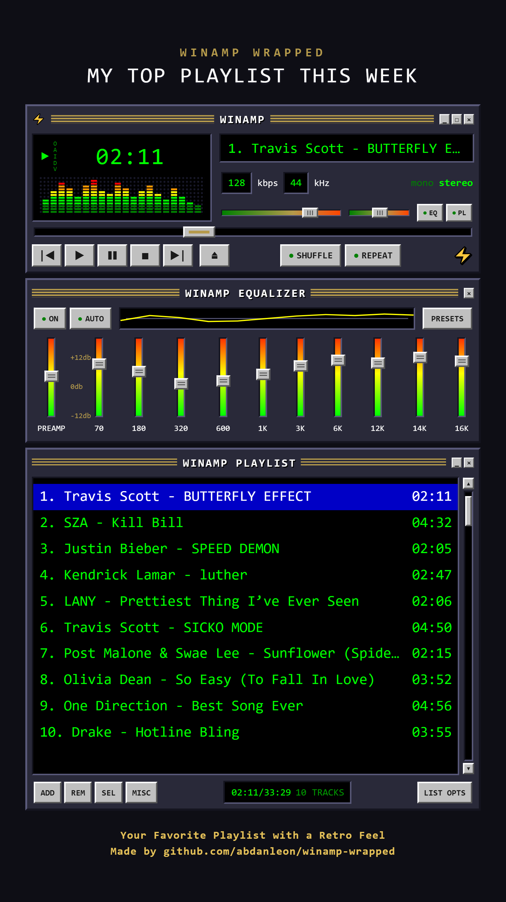

## Winamp Wrapped
Website pembuat gambar berisi kumpulan lagu-lagu pilihan (playlist) yang hadir dalam nuansa retro khas Winamp Classic yang ikonik. Terinspirasi dari Spotify Wrapped dan nostalgia yang muncul.

## Tentang Winamp
Winamp adalah perangkat lunak pemutar media (terutama musik dan audio) legendaris untuk Windows yang pertama kali dirilis pada 21 April 1997 oleh Justin Frankel dan Dmitry Boldyrev melalui Nullsoft. Nama "Winamp" berasal dari gabungan kata Windows dan AMP (Advanced Multimedia Products). Winamp sangat populer pada akhir 1990-an hingga awal 2000-an.

## Tutorial (Cara Pakai)
- Tambah lagu di kolom **Cari Lagu Otomatis** atau **Tulis Lagu Manual**.
- Ubah urutan lagu atau hapus lagu di **Daftar Lagu Terpilih** bila diperlukan.
- Lihat hasil di bagian **Live Preview**.
- Klik tombol **Download Gambar**, hasil akan tersimpan dalam file .png dan siap dibagikan ke media sosial.

## Contoh Gambar

